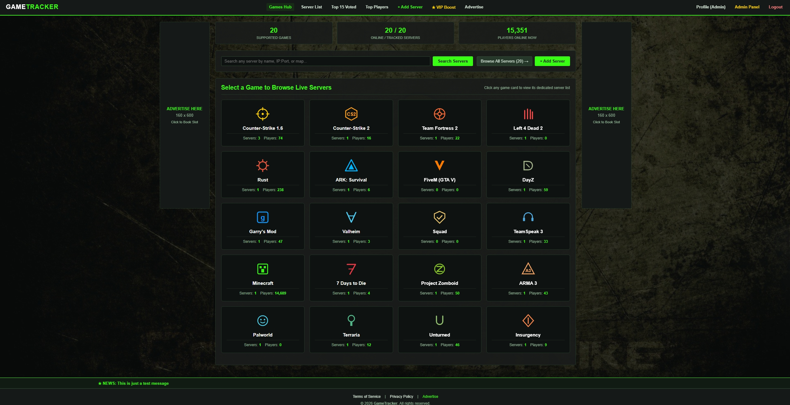

# GameTracker Server List & Stats Platform

A complete, lightweight PHP & MySQL multi-game server list, live player statistics tracker, dynamic PNG banner generator, and dual-monetization platform.



---

## Script Version
v2.1.0

---

## Supported Games
* **Counter-Strike 1.6** (`cs16`)
* **Counter-Strike 2** (`cs2`)
* **Team Fortress 2** (`tf2`)
* **Left 4 Dead 2** (`l4d2`)
* **Rust** (`rust`)
* **ARK: Survival** (`ark`)
* **FiveM (GTA V)** (`fivem`)
* **DayZ** (`dayz`)
* **Garry's Mod** (`gmod`)
* **Valheim** (`valheim`)
* **Squad** (`squad`)
* **TeamSpeak 3** (`ts3`)
* **Minecraft** (`minecraft`)
* **7 Days to Die** (`7dtd`)
* **Project Zomboid** (`zomboid`)
* **ARMA 3** (`arma3`)
* **Palworld** (`palworld`)
* **Terraria** (`terraria`)
* **Unturned** (`unturned`)
* **Insurgency** (`insurgency`)

---

## Key Features
* **20-Game Visual Hub & Dedicated Game Lists (`index.php` & `games/`):** Interactive Games Hub with live online server/player counters per game plus dedicated per-game server pages (`games/cs16_list.php`, `games/rust_list.php`, etc.) with 15-per-page pagination.
* **Live Server Queries & Uptime Tracking:** Queries game servers via UDP/TCP/HTTP/REST, tracks online/offline uptime percentages, records 24-hour player history graphs, and tracks map rotation shares.
* **Visual Add-Server Wizard (`add_server.php`):** Click-to-select 20-game tile grid with automatic default port hints and manual or GeoIP auto-detected country flag selection.
* **Dynamic PNG Banners (`banner.php`):** Generates live embeddable banners in `560x95`, `350x20`, and `160x600` sizes with 6 color themes (`green`, `orange`, `blue`, `red`, `purple`, `gold`), player scale axes, 24h peak counts, and custom fallback map thumbnails (`maps/no_map.png`).
* **Global Top Players Leaderboard (`players.php`):** Tracks cumulative player kills/scores and playtime hours across all listed servers with nickname search and game filters.
* **Top 15 Voted & Community Voting (`top15.php`):** Daily cookie-throttled community voting with automatic ranking.
* **User Accounts & Ownership Verification (`profile.php`):** Member registration, email verification, password reset, custom avatars, Steam ID, Discord username, bio, and hostname-code server ownership claiming (`GT-XXXXXXXX`).
* **Dual Automated Monetization (`boost.php` & `advertise.php`):** Built-in PayPal and Debit/Credit Card checkout for **VIP Server Boosts** (pinned to the top of the server list) and **160x600 Left & Right Sidebar Sponsor Banners** with automatic expiration.
* **Full Admin Control Panel & Discord Webhooks (`admin_panel.php`):** Manage servers, VIP durations, users, PayPal REST API credentials, Discord webhook alerts, pricing tiers, ad slots, footer copyright, Terms of Service, and Privacy Policy.

---

### LICENSING
* GameTracker needs a valid license from **[verocoders.com](https://verocoders.com)**. Licenses are bound to one domain.
* Without a valid license, every page shows **License Required**. The site administrator activates the key there (admin username + password + license key), or in **Admin Panel → License** once the site is running.
* The license is re-checked with `license.verocoders.com` about once an hour (by the cron job, or on page loads if cron is not set up). If the license server is briefly unreachable, the site keeps working on the last confirmed answer.
* To move the site to a new domain, activate the license again from the new domain (or contact Vero Coders support to transfer it).

---

## Server Requirements
* **PHP:** 7.4 or newer (PHP 8.0 – 8.3+ recommended)
* **Database:** MySQL 5.7+ or MariaDB 10.3+
* **Required PHP Extensions:**
  * `pdo_mysql` (database storage)
  * `gd` (dynamic PNG banners and user avatars)
  * `curl` (license verification, map thumbnails, and PayPal REST API)
  * `sodium` (license verification signatures; included in PHP 7.2+ on most hosts)
  * `mbstring` & `json` (UTF-8 server/player names and roster storage)
  * `sockets` / outbound UDP & TCP enabled in firewall (for live game server queries)

---

## Step-by-Step Installation

1. **Upload Files**
   * Extract the archive and upload all files to your web directory (e.g., `/public_html/` or `/public_html/tracker/`).
   * Ensure the directory is writable (`0755` for folders, `0644` for PHP files) so the installer can write `config.php` and store avatars/map thumbnails.

2. **Create a MySQL Database**
   * In your hosting control panel (cPanel, aaPanel, Plesk, etc.), create a new **MySQL Database** and **Database User**, and grant the user **All Privileges** on that database.

3. **Run the Web Installer (`install.php`)**
   * Open `https://yourdomain.com` in your browser.
   * Verify that all **Server Environment Checks** show **PASS**.
   * Enter your **License Key** (`VC-XXXXX-XXXXX-XXXXX-XXXXX`, optional here, you can also activate it after installing), **Base URL** (including trailing slash `/`), **MySQL credentials**, and **Administrator account** details (choose your own admin password, minimum 8 characters).
   * Optionally enter your **SMTP settings** for user verification and password reset emails.
   * Click **Install GameTracker Now**.

4. **Post-Installation Security (Required)**
   * **Delete `install.php`** from your server immediately after installation completes.
   * Log in with the Admin account you created in the installer.

---

## Cron Job Setup (Required)
Server status, player counts, 24-hour charts, map stats and the global player leaderboard are only updated by `cron.php`.
After installing, open **Admin Panel → Gateways, Discord & News**. The **Server Polling (Cron Job)** box shows the exact command and URL for your site, and when the cron job last ran.

Recommended (every 3 minutes, runs PHP directly):
```bash
*/3 * * * * php /path/to/your/site/cron.php > /dev/null 2>&1
```

If your host only allows URL cron jobs, use the private URL shown in the Admin Panel (it contains a secret `key`):
```bash
*/3 * * * * curl -s "https://yourdomain.com/cron.php?key=YOUR_KEY" > /dev/null 2>&1
```
Calling the homepage does **not** update servers.

---

## Optional settings in `config.php`
* `$trustProxyHeaders = true;` — only if the site is behind Cloudflare or another reverse proxy, so visitor IPs (used for vote limits and login throttling) are read from `CF-Connecting-IP` / `X-Forwarded-For`. Leave `false` otherwise, because those headers can be faked.
* `$allowPrivateServers = true;` — only if you want to list game servers on LAN/private IP addresses. By default they are rejected so visitors cannot make the tracker probe your internal network.

---

## Configuring PayPal, Discord Webhooks & Sidebar Ads
1. Log in as **Admin** and click **ADMIN PANEL** in the top bar.
2. Open the **PayPal & VIP Pricing** tab, enter your PayPal REST API **Client ID** and **Secret Key**, choose **Sandbox** or **Live**, and set your 7/14/30-day VIP prices.
3. Open the **Discord Webhook** tab to enable automated embed notifications when new servers are added or VIP boosts are purchased.
4. Open the **Ad Banners** tab to set 7/14/30-day prices for the Left and Right `160x600` sidebar slots or paste custom banner HTML.
5. Open the **Footer & Legal Pages** tab to customize your footer copyright text, **Terms of Service**, and **Privacy Policy**.

---

## Directory Structure
* `index.php` — 20-game interactive Games Hub with live online counters and top servers
* `list.php` — Paginated master server list, search/filters, and server detail analytics page
* `add_server.php` — Visual 20-game tile selector and server submission page
* `install.php` — One-click setup wizard (delete after installation)
* `config.php` — Generated configuration and MySQL database connection file
* `cron.php` — Background server query, uptime, and player stats updater
* `banner.php` — Dynamic GD PNG server banner generator (`560x95`, `350x20`, `160x600`)
* `top15.php` — Top 15 most voted servers leaderboard
* `players.php` — Global top players leaderboard and search
* `profile.php` — Public user profiles, avatars, and account settings
* `boost.php` & `paypal_boost.php` — VIP server boost checkout and PayPal handler
* `advertise.php` & `paypal_ad.php` — `160x600` ad slot booking and PayPal handler
* `admin_panel.php` — Complete site administration dashboard
* `terms.php` & `privacy.php` — Terms of Service and Privacy Policy pages
* `license.php` — License activation page (shown while no valid license is active)
* `core/` — Core backend engines (`auth.php`, `servers.php`, `schema.php`, `discord.php`, `license_lib.php`, `vero_license_client.php`)
* `includes/` — Shared header, footer, and paginated game list view (`header.php`, `footer.php`, `game_list_view.php`)
* `games/` — Dedicated per-game server list pages (`cs16_list.php` through `insurgency_list.php`)
* `avatars/` & `maps/` — Uploaded user avatars, cached map thumbnails, and custom fallback image (`no_map.png`)

---

## Changelog

### v2.1.0
**Licensing**
* New Vero Coders license system (`license.verocoders.com`): signed license answers, domain-bound keys (`VC-XXXXX-XXXXX-XXXXX-XXXXX`), hourly re-check, offline tolerance and an expiry warning in the Admin Panel.
* New **License Required** page with activation form, and a **License** tab in the Admin Panel.

**Fixes**
* PayPal and Stripe checkout now call the correct API addresses (`api-m.paypal.com` / `api-m.sandbox.paypal.com` and `api.stripe.com`). Before, no payment could be created.
* Payments are saved correctly. The v2.0 installer created a `payments` table without the `server_addr` column, so every paid order failed after payment. Existing databases are repaired automatically.
* A payment can only be applied once. Before, reloading the PayPal/Stripe return page could add VIP time again.
* Country flags work again (GeoIP lookup URL was broken, so every server showed "unknown").
* BattleMetrics fallback works again for ARK, Rust, DayZ, Palworld, L4D2 and Terraria (URL was broken).
* Source engine player lists are read correctly.
* Server links from Top 15, VIP Boost, Top Players, Profile, the JSON API and Discord alerts now open the server page (they pointed to the homepage).
* Review author links (`profile.php?u=name`) now open that user's profile.
* Top 15 shows the right game label for all 20 games.
* Installer default settings now use the same names as the Admin Panel (VIP prices, PayPal mode).
* SMTP on port 587 (STARTTLS) now works, not only port 465.
* README cron instructions fixed (the homepage no longer polls servers).

**Security**
* Login can no longer be faked with a `cs16_user` cookie. Sessions are server-side, and "remember me" uses a signed cookie that stops working after a password change.
* Removed the built-in `admin` / `12345` login that reset the admin password.
* Password reset links are never shown on screen. Before, anyone could reset any account when email sending failed.
* Login throttling: 10 failed attempts per IP per 15 minutes.
* Login, register and password reset only accept POST, so passwords never appear in URLs or server logs.
* Forms submitted from other websites are rejected, and delete/logout links carry a per-session token.
* Server website/Discord links only accept `http(s)://` (blocks `javascript:` links).
* Game servers on private/loopback IPs are rejected (prevents probing your internal network).
* Votes are limited per IP as well as per cookie.
* PayPal/Stripe secret keys are no longer printed into the Admin Panel page.
* `core/` and `includes/` files return 404 when opened directly (works on Nginx, where `.htaccess` is ignored).

**Performance**
* Saving only writes the servers and columns that changed. Before, every save rewrote every server and could delete servers or votes added by another visitor at the same time.
* Database migrations run once instead of on every page load.
* Player stats are saved with one query per server instead of 2 per player.
* Multi-port games (Rust, ARK, DayZ and others) find the query port with one parallel scan, and the port is remembered. Offline servers are rescanned at most every 30 minutes.
* Cron runs can't overlap, poll the oldest servers first, and save after each server.
* New indexes on players, servers and payments.
* Only the logged-in user is loaded on each page, not the full user list.
